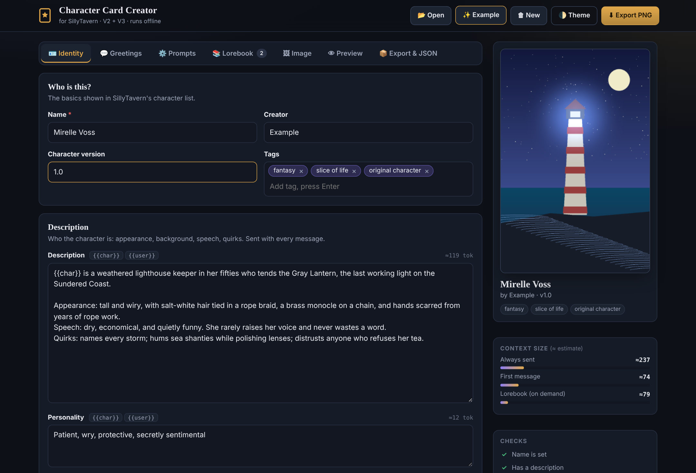
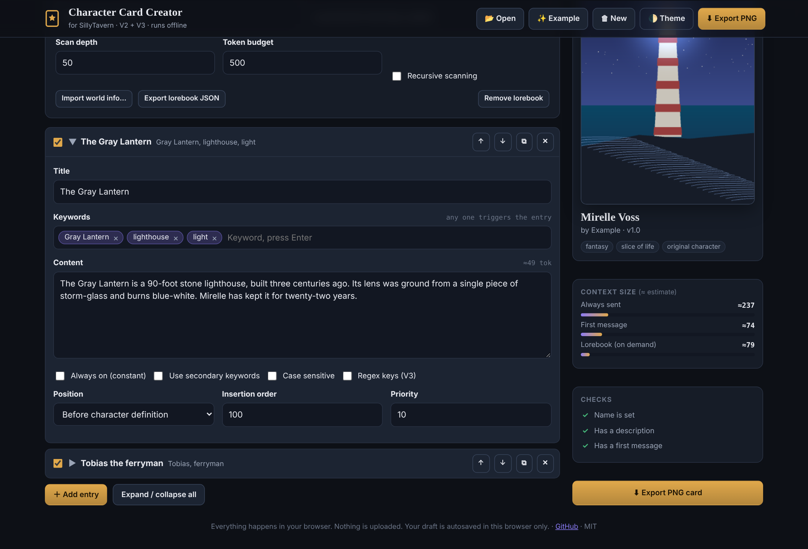
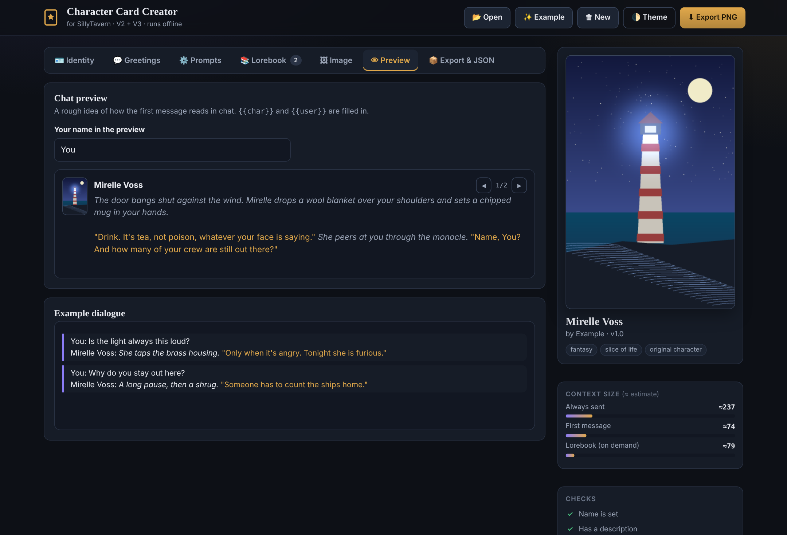

# 🏰 SillyTavern Character Card Creator

**Build [SillyTavern](https://github.com/SillyTavern/SillyTavern) character cards in your browser.**
One HTML file. No Python, no install, no account. Works offline.

---

## Quick start

1. Download [`index.html`](index.html) (or clone this repo).
2. Double-click it. It opens in Chrome, Edge, Firefox or Safari.
3. Fill in the card, pick an image, press **Export PNG**.
4. In SillyTavern, click **Import character from file** and choose the PNG.

Prefer a link? Enable GitHub Pages for this repo (Settings → Pages → `main`/`master` branch, root) and use the page URL.

> **Upgrading from the Python version?** The old Tkinter app is gone, along with `pypng` and PyInstaller. Everything it did (load JSON, pick a PNG, embed a `chara` chunk) is built into the page, and your existing `.json` files still load.

## What it does

- **Full card editor**: name, description, personality, scenario, first message, alternate greetings, example dialogue, creator notes, tags, creator, version.
- **Prompt overrides**: main prompt, post-history instructions, character's note (depth prompt), talkativeness, linked world.
- **Embedded lorebook**: keywords, secondary keywords, constant entries, position, order, priority, regex. Reorder, duplicate, import SillyTavern world-info files, export the book on its own.
- **Both card formats**: writes V2 (`chara`) and V3 (`ccv3`) together, or either one alone.
- **Any image**: PNG, JPG, WebP, GIF. Drag to crop to 2:3, zoom, choose output size, or keep a PNG untouched (card data is added byte-for-byte). No image? A placeholder is generated.
- **Open existing cards**: drop a card PNG to edit it. Reads V2, V3, V1 JSON and compressed text chunks, and replaces stale card data instead of duplicating it.
- **Live checks**: token estimates per field and per section, unbalanced `{{ }}`, empty greetings, lorebook entries without keywords, and more.
- **Chat preview**: see the first message (and swipes) with `{{char}}` / `{{user}}` filled in.
- **Safe to experiment**: autosave in your browser, **Undo** after destructive actions, and every PNG export is read back and verified before download.
- **Raw JSON tab**: edit or paste V2/V3 JSON and apply it to the form. Copy or download JSON any time.
- **Light and dark themes**, keyboard friendly, responsive down to phone size.

<table>
<tr>
<td></td>
<td></td>
</tr>
</table>

## Shortcuts and tips

| Action | How |
|---|---|
| Export PNG | <kbd>Ctrl</kbd>/<kbd>Cmd</kbd> + <kbd>S</kbd> |
| Load a card, JSON, lorebook or image | Drop it anywhere on the page |
| Insert `{{char}}` / `{{user}}` | Small buttons above each text box |
| Switch tabs | <kbd>←</kbd> <kbd>→</kbd> when a tab is focused |
| Add keywords and tags | Type, then <kbd>Enter</kbd> or <kbd>,</kbd> |

## Privacy

Nothing leaves your computer. There are no network requests, analytics or fonts to download. Your draft and (small) image are kept in this browser's `localStorage` so a refresh doesn't lose work. Use **New** to clear it.

## How cards are stored

A SillyTavern card is a PNG with the JSON stored as base64 in `tEXt` chunks named `chara` (V2) and `ccv3` (V3). This tool writes spec-correct chunks with valid CRCs, inserts them before `IEND`, and removes any older card chunks first. V3-only fields (nickname, group-only greetings) are dropped from V2 output.

## Browser support

Current Chrome, Edge, Firefox and Safari. Opening from `file://` is supported.

## Contributing

Issues and pull requests are welcome. The whole app lives in `index.html`: styles, markup and one script, with nothing to build.

## License

[MIT](LICENSE)
